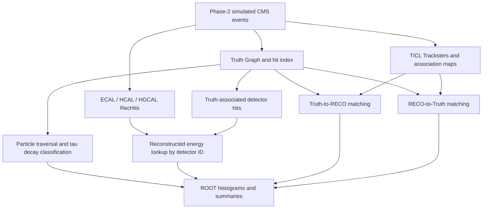

# CMS Truth Graph Validation & Particle Reconstruction Matching

**CERN Summer Research Project (2026) · CMS Experiment · C++ / CMSSW / ROOT**

A scientific analysis plugin for studying how simulated particles are represented in the **CMS Truth Graph** and how reliably they can be associated with reconstructed **TICL Tracksters** in the Phase-2 detector environment.

This project combines **graph traversal, detector-hit association, physics validation, and bidirectional matching evaluation** to investigate the connection between particle-level simulation and reconstructed detector objects.

> **Project scope:** Research analysis within CMSSW, not a standalone machine-learning model or general-purpose executable. The repository contains the analyzer and an example CMSSW job configuration; running it requires compatible CMS software and input data products.

## At a glance

| Area | What was investigated |
| --- | --- |
| Truth Graph validation | Particle identities, ancestry, kinematics, and tau decay modes |
| Detector response | Truth-associated calorimeter hits and reconstructed energy response |
| Truth → RECO matching | Whether charged pions from tau decays have a sufficiently good Trackster association |
| RECO → Truth matching | Whether reconstructed Tracksters can be associated with truth-level tau-decay pions |
| Working points | Nominal, tight, and loose RECO → Truth association maps |
| Output | ROOT histograms, efficiency distributions, and event-summary logs |

## Why this matters

In the CMS experiment, simulated events provide information about the particles that *actually* generated detector signals, while reconstruction algorithms infer physics objects from those signals. Evaluating reconstruction performance requires a consistent way to connect these two views.

The **CMS Truth Graph** provides a unified representation of generator-level and simulation-level particle history. This project uses that representation to trace particle ancestry, inspect associated calorimeter energy, and assess links to reconstructed objects. The work focuses particularly on charged pions originating from tau decays in the forward calorimeter region.

## Analysis workflow



### 1. Validate particle history and tau decays

The C++ analyzer iterates over `truth::Graph` particle views, checks generator/simulation information, follows parent and child relationships, and records particle multiplicities and kinematics. For generator-level tau leptons, it distinguishes leptonic decays (`e`, `μ`) from hadronic decays and counts hadronic channels by charged-prong and neutral-pion multiplicity.

**Research finding:** In the project's TenTau analysis, the observed broad tau decay fractions were approximately **64% hadronic, 18% electronic, and 18% muonic**, consistent with expected overall behavior. These are reported analysis findings, not newly rerun results from this repository snapshot.

### 2. Study calorimeter energy response

The analyzer obtains calorimeter hits associated with truth particles using `truth::LogicalGraphHitIndex` and `truth::SubgraphHitView`, then looks up reconstructed energies using detector IDs. It fills distributions of truth-associated simulated energy, reconstructed hit energy, and reconstructed-to-truth particle energy response, including dependence on pseudorapidity (`η`) and transverse momentum (`pT`).

For selected tau decay products, it also separates electromagnetic and hadronic calorimeter energy contributions to study their relative response.

**Research finding:** The reported tau energy-response study did not show a clear dependence on `η` in the analyzed sample. This observation is sample- and selection-dependent.

### 3. Evaluate bidirectional particle matching

The analyzer consumes `ticl::AssociationMap<ticl::mapWithSharedEnergyAndScore>` products. For **Truth → RECO**, it selects charged pions with a tau ancestor and examines their candidate Trackster matches. For **RECO → Truth**, it inspects the reverse association maps and checks whether the associated truth particle is a charged pion originating from a tau decay.

For each candidate, the **lowest association score is preferred**; a score below **0.6** is used as the working definition of a good match. The analysis focuses on the HGCAL acceptance region, approximately **1.5 < |η| < 3.0**.

The nominal, tight, and loose RECO → Truth working points are inspected separately. The nominal map is also used for the reverse-direction efficiency histogram.

**Research finding:** The project reported increasing matching efficiency with `pT`, with RECO → Truth generally higher than Truth → RECO. These curves should be interpreted alongside the selection and histogram-denominator caveats below.

## Implementation

| Technology | Role |
| --- | --- |
| **C++** | Event processing, graph traversal, hit lookup, matching selection, and summary counters |
| **CMSSW** | CMS event framework, data formats, modules, and configuration |
| **ROOT** | `TH1F` / `TH2F` histograms and ROOT output via `TFileService` |
| **CMS Truth Graph** | Unified generator/simulation particle relationships |
| **TICL** | Reconstructed Tracksters and truth association maps |
| **Python** | `cmsRun` job configuration and product wiring |

### Key implementation decisions

- **Token-based input access:** The analyzer declares `consumes` tokens for required event products.
- **Detector-ID lookup:** A hash map links detector-cell IDs to reconstructed hit energies for efficient per-event lookup.
- **Explicit matching directions:** Truth → RECO and RECO → Truth maps are configured independently to avoid accidentally reversing the association semantics.
- **Sample-specific execution:** `doTenTau` and `doDYtoLL` enable different analysis paths.
- **Structured outputs:** Histograms are booked at job start, filled during event processing, and summarized at job end.

## Repository files

```text
.
├── README.md
├── MyTruthAnalyzer.cc       # CMSSW EDAnalyzer implementation
└── myTruthAnalyzer_cfg.py   # Example CMSSW job configuration
```

A complete CMSSW package also requires appropriate package metadata/build configuration (such as `BuildFile.xml`), which is **not included** in the supplied files.

## Requirements and running the analysis

This is a **CMSSW plugin**, not a standalone C++ program. It requires a compatible Phase-2 CMSSW checkout with Truth Graph support, upstream truth/reconstruction association producers, and input files containing the expected collections.

The development context included Phase-2 CMSSW pre-release environments. Exact compatibility with a fresh CMSSW checkout has **not** been independently verified for this repository snapshot.

1. Place the source in a suitable CMSSW plugin package and provide the required `BuildFile.xml` and plugin dependencies.
2. Activate the matching CMSSW runtime environment.
3. Edit `myTruthAnalyzer_cfg.py`: replace the example EOS input path with a file you can access; select `doTenTau` or `doDYtoLL`; verify the configured product labels exist in that file/job.
4. Build and execute from the CMSSW environment:

```bash
cd "$CMSSW_BASE/src"
eval "$(scram runtime -sh)"
scram b -j8
cmsRun path/to/myTruthAnalyzer_cfg.py
```

The configuration loads `Validation.Configuration.truthPrevalidation_cff` and `Configuration.Geometry.GeometryExtendedRun4D122Reco_cff`, and writes histograms through `TFileService` (configured as `myTenTau.root` in the provided example).

> **Reproducibility status:** These are CMSSW integration steps, not a claim that the uploaded source currently compiles and runs unchanged. See the engineering notes below before attempting a fresh build.

## Selected outputs

| Study | Representative ROOT histograms |
| --- | --- |
| Tau decay and particle counts | `GenTauNum`, `SimTauNum`, `TruthTauNum`, `TauDecayVtxRadius` |
| Particle ancestry | `GenTauMother`, `GenPhtMother`, `GenEleMother` |
| Energy response | `TauSimHitE`, `TauRecHitE`, `TauEResponse`, `TauEResponseVsEta`, `TauEResponseVsPt` |
| EM / hadronic sharing | `1ProngBFECALVsEta`, `1ProngBFHCALVsEta`, `1ProngECALoverHCALVsEta` |
| Truth → RECO | `AssociationScoreOfPionBestMatch`, `TruthPionPtAll`, `TruthPionPtMatched`, `TruthToRecoEfficiency` |
| RECO → Truth | `TrackesterToPionBestMatchNominal`, `TrackesterToPionBestMatchTight`, `TrackesterToPionBestMatchLoose`, `RecoToTruthEfficiency` |
| Drell–Yan checks | `GenZMass`, `GenZPt`, `GenZEta`, `GenEleFromZPt`, `GenMuFromZPt` |

For a public portfolio, add **actual exported plots** from the analysis (especially tau branching fractions, response vs. `η`, score distributions, and the two efficiency curves). Avoid adding illustrative plots that could be mistaken for measured results.


## Next steps

- Make acceptance, score threshold, and histogram configuration explicit parameters.
- Consolidate repeated matching logic across nominal/tight/loose working points.
- Add denominator-safe energy calculations and validate efficiency selections.
- Provide a CMSSW `BuildFile.xml`, a tested release identifier, and a small accessible validation input where permitted.
- Add reference ROOT plots and documented analysis settings to support independent interpretation.

## Research context and acknowledgments

Developed during **Summer 2026 research training at CERN**, in the context of CMS Phase-2 reconstruction and Truth Graph validation. The work used CMS software, simulation, and reconstruction infrastructure developed by the broader collaboration. The analyzer and configuration in this repository represent the project-specific analysis work; they should not be interpreted as authorship of the underlying CMS Truth Graph or TICL frameworks.

## References

- [CMS Truth Graph documentation](https://cms-truth.docs.cern.ch/)
- [CMS Software (CMSSW)](https://github.com/cms-sw/cmssw)

